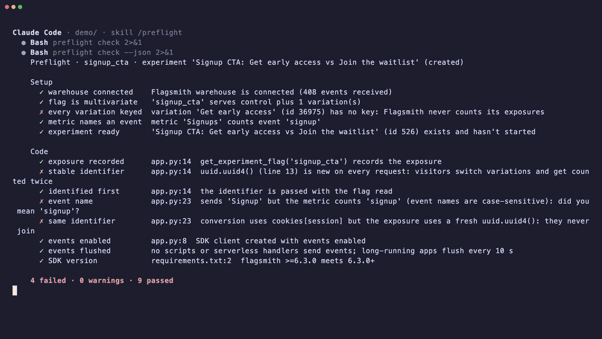

# Preflight

**An AI agent that takes a Flagsmith experiment from idea to production, with a human approval at every step that changes something.**

Toggle Wars entry · Track 2: AI Agents and Feature Flags

## The problem

A Flagsmith experiment can look healthy while its numbers mean nothing: a fresh ID on every request, an event named `Signup` when the metric counts `signup`, or a variation without a key.
Flagsmith's own setup guide lists these as the [most common causes](https://docs.flagsmith.com/experimentation/set-up-with-a-coding-agent#after-it-runs) of missing exposures and conversions, and the organiser's [How to Win post](https://www.wemakedevs.org/blogs/how-to-win-toggle-wars) calls them "wiring mistakes that invalidate a result".

**Field scan (Thu Nov 26):** 20 public GitHub repos call Flagsmith's experiment SDK. Preflight's checks pass cleanly in **8**. **12** leave at least one wiring question that static checks can't settle (an identifier passed in from elsewhere, client options in a variable, a simulator minting ids), and **1** pins an SDK too old to send experiment events. Counts only, no repo names: [fieldscan/results.json](fieldscan/results.json). A first pass counted 13 failures; auditing them turned up scanner false positives (code inside test-fixture strings, function definitions, options in variables), now fixed and covered by tests.



## The recorded run

Run once, end to end, on Flagsmith Cloud on Thu Nov 26 against the demo app. Traffic was **simulated**: "Join the waitlist" truly converts at 10%, "Get early access" at 14%.

| Stage | What happened |
|---|---|
| 1 Design | One line in. The agent wrote [plan.md](docs/demo-plan.md) (~1,800 users per variation for +30% on a 10% baseline), and on a yes created the metric and the experiment. |
| 2 Check | `4 failed · 9 passed`: an unkeyed variation, `uuid4()` per request, `'Signup'` vs `'signup'`, and a session id for the conversion. |
| 3 Fixes | One yes per fix. The agent's smallest fix reused the app's existing session cookie as the visitor id ([diff](docs/demo-fixes.md)). Then `13 passed`. |
| 4 Start | `[y/N] y`, running. |
| 5 Readout, 205 users | **Not callable yet**: lift +42.2%, 95% interval −67.9% to +152.2%, about 520 more users per variation needed. At the same moment the dashboard said "77% Winner Probability Confirmed … Consider rolling out early_access" ([screenshot](docs/dashboard-at-205-users.png)). |
| 5 Readout, 6,005 users | **early_access wins**: 12.5% vs 9.4%, lift +33.4%, 95% interval +13.9% to +52.9%. |
| 6 Ship | On a yes: experiment completed, results frozen, and every new identity gets "Get early access" (`flagsmith evaluate`, and the running app). No redeploy. |
| 7 Clean up | On a yes, the [cleanup diff](docs/demo-cleanup.md) removed the flag read and the losing branch, then `signup_cta` was archived. |
| Log | 8 approvals, 0 declines: [demo-approvals.jsonl](docs/demo-approvals.jsonl). |

## What it is

- **`preflight`**, a Python CLI, holds the deterministic gates: the checks, the gated start, the honest readout and the gated ship.
- **`/preflight`**, a Claude Code skill, is the agent. It drives the CLI stage by stage, writes the plan, the fixes and the cleanup diff, and stops for a yes before every change.
- **`.preflight/approvals.jsonl`** records every yes and no: who, what, when, and the human's words.

## The seven stages

| # | Stage | Kind | What happens |
|---|---|---|---|
| 1 | Design | proposal | From a one-line ask, the agent writes `.preflight/plan.md`: hypothesis, success event, variations, users per variation. On a yes, `preflight create` makes the flag (every variation keyed), the metric and the experiment, without starting it. |
| 2 | Preflight | **gate** | `preflight check`: setup and code checks, each with `file:line` and a one-line reason. |
| 3 | Approve | proposal | The agent explains each failure, writes the smallest fix, shows the diff and waits for a yes. Then it re-runs the check. |
| 4 | Run | **gate** | `preflight start` refuses while any check fails, then asks `Start <experiment>? This locks <flag>. [y/N]`. |
| 5 | Evaluate | **gate** | `preflight readout` refreshes the results and names a winner only when its 95% credible interval excludes zero and no guardrail moved the wrong way. Otherwise: "not callable yet", the interval, and roughly how many more users it needs. |
| 6 | Ship | **gate** | `preflight ship` works only after a callable result. On a yes it ends the experiment and serves the winner to everyone through Flagsmith, with no redeploy. |
| 7 | Clean up | proposal | A diff that removes the experiment call and the losing branch, plus archiving the flag. `preflight archive` refuses while code still reads the flag. |

## Install

Needs Python 3.11+, the [Flagsmith CLI](https://docs.flagsmith.com/integrating-with-flagsmith/CLI) v2+, and a Flagsmith environment with a connected warehouse (Environment Settings › Warehouse › Flagsmith › Enable).

```sh
brew install Flagsmith/tap/flagsmith && flagsmith login
pip install git+https://github.com/Adarsh-Polsey/flagsmith-preflight
```

For the agent, copy `.claude/skills/preflight/` into your app's `.claude/skills/` (or `~/.claude/skills/`) and type `/preflight` in Claude Code.

## Quickstart (2 minutes, on the demo app)

The demo is a one-page signup app (`demo/`) with four planted bugs. It needs a Flagsmith project you can write to.

```sh
git clone https://github.com/Adarsh-Polsey/flagsmith-preflight && cd flagsmith-preflight
python3 -m venv .venv && . .venv/bin/activate && pip install -e . -r demo/requirements.txt
cd demo
flagsmith init        # pick your project and environment; writes flagsmith.json (gitignored)
./seed.sh             # the "before" state: flag signup_cta, its variation added without a key
preflight init --flag signup_cta --baseline 0.10 --mde 0.30
preflight create --flag signup_cta --control "Join the waitlist" \
  --variant "early_access=Get early access" --event signup --metric Signups \
  --name "Signup CTA" --hypothesis "'Get early access' gets 30% more signups"
preflight check       # four red: unkeyed variation, uuid4 per request, 'Signup' vs 'signup', session id vs visitor id
```

Success looks like `4 failed · 0 warnings · 9 passed`. From here, run `claude` and type `/preflight fix the failing checks`, or fix them by hand (the diff is in [docs/demo-fixes.md](docs/demo-fixes.md)) and carry on:

```sh
preflight set-key <variation id from the check> early_access
preflight check                                         # 13 passed
FLAGSMITH_ENVIRONMENT_KEY=<your environment key> python app.py &
preflight start                                         # asks [y/N]
python simulate.py --visitors 200 && preflight readout  # SIMULATED traffic; usually not callable yet
python simulate.py --visitors 2500 && preflight readout # Flagsmith allows one refresh every 5 minutes
preflight ship                                          # only if the readout named a winner
```

## The checks

### Setup (from the Flagsmith API)

| Check | Fails when | Why it matters |
|---|---|---|
| warehouse connected | the environment's warehouse isn't `connected` | Flagsmith rejects events for environments without one. |
| flag is multivariate | the flag is boolean, or has no variations | A flag made multivariate late throws away everything collected before. |
| every variation keyed | a variation has no key | Exposures are attributed by key; an unkeyed variation is never counted. |
| metric names an event | the experiment has no metric, or it has no event | Nothing would decide a winner. |
| experiment ready | it doesn't exist, is already running, or has ended | Setup fixes after start come too late: the flag is locked. |

### Code (Python via `ast`, JS/TS via a small tokenizer)

| Check | Fails when | Why it matters |
|---|---|---|
| exposure recorded | no `get_experiment_flag` / `getExperimentFlag` / `useExperiment` reads the flag | Nothing enrols users. |
| stable identifier | the identifier comes from `uuid4()`, `randomUUID()`, `Math.random()`, `Date.now()` or a request id, made per request. Passes on a cookie, session or user id (including get-or-create cookies); warns when it can't tell, and in traffic simulators that mint one id per simulated visitor | Visitors switch variations and are counted twice. |
| identified first | no identifier is passed, or `identify()` runs after the flag is read | Exposures without an identity are skipped. |
| event name | `track_event` / `trackEvent` doesn't send the metric's event exactly; suggests the near miss (`'Signup'` → `'signup'`) | Event names are case-sensitive; unmatched events are silently ignored. |
| same identifier | the conversion uses a different identifier from the exposure (e.g. session id vs visitor id) | Conversions only count after the same identity's exposure. |
| events enabled | no SDK client enables `enable_events` / `enableEvents` (warns when options come from a variable, or when one client has them off beside one that has them on) | Nothing is sent. |
| events flushed | a script or serverless handler sends events and exits without `close()` / `flush_events()` / `flushEvents()` | Buffered events are dropped at exit. |
| SDK version | the pinned or locked version can't reach `flagsmith` 6.3.0, `@flagsmith/nodejs` 9.1.0 or `@flagsmith/flagsmith` 12.4.0, or the old `flagsmith-nodejs` / `flagsmith` npm packages are used (a range that merely allows older versions warns) | Older SDKs can't send experiment events. |

### Smoke (optional, after start)

`preflight smoke --url http://localhost:5055 --convert /signup --visitors 100` sends visitors through the running app, each twice with its own cookie jar, then refreshes the results. It checks both variations got exposures, conversions arrived, and exposures are close to N, not 2N.

## How Flagsmith is used

Preflight never holds an admin key: every call goes through the logged-in Flagsmith CLI.

| Stage | Flagsmith CLI | Admin API (via `flagsmith api`) |
|---|---|---|
| 1 Design | `feature get --json`, `feature create`, `feature variant add --key` | `POST environments/{env}/experiment-metrics/`, `POST environments/{env}/experiments/` (with `experiment_rollout` listing every variation) |
| 2 Check | `feature get --json` | `GET environments/{env}/warehouse-connections/`, `GET .../experiments/`, `GET .../experiments/{id}/`, `GET .../experiment-metrics/{id}/` |
| 3 Fix a key | | `GET` then `PUT projects/{p}/features/{f}/mv-options/{id}/` |
| 4 Start | | `POST .../experiments/{id}/start/` |
| 2c, 5 Readout | | `POST .../results/refresh/`, `POST .../exposures/refresh/`, `GET .../results/`, `GET .../exposures/` |
| 6 Ship | `evaluate <flag> --identity <new id> --json` (verifies 5 new identities get the winner) | `POST .../experiments/{id}/complete/` with `{"rollout_decision": "variant", "rollout_variant": id}` |
| 7 Archive | `feature update <flag> --archive` | |

The demo app uses the Python SDK: `Flagsmith(environment_key=..., enable_events=True)`, `get_experiment_flag("signup_cta", identifier=visitor_id())` and `track_event("signup", identifier=visitor_id())`. Results come from Flagsmith's own Bayesian engine; Preflight reads `lift`, `ci_low`, `ci_high`, `chance_to_win`, `srm_p_value` and the quarantined-identity count, and decides only whether the result is callable.

## The approvals log

Every change asks first. In a terminal the CLI prompts `[y/N]`; in Claude Code the agent asks in chat and passes the reply as `--yes --note "<their words>"` (`--yes` without a note is refused). Both land in `.preflight/approvals.jsonl`, declines included:

```json
{"at": "2026-11-26T08:54:19+05:30", "who": "Adarsh-Polsey", "stage": "fix", "action": "stable identifier: use the session cookie as the visitor id in app.py, set it once with a 1-year max_age", "answer": "y", "via": "chat", "note": "yes"}
```

`preflight approvals` prints it as a table. The demo run's log is in [docs/demo-approvals.jsonl](docs/demo-approvals.jsonl).

## How the demo video was made

The agent ran as real `claude -p` turns in `demo/`, with a narrow tool allowlist (read, edit, and `preflight` / `flagsmith` / `git diff` commands). The human's replies in the video ("yes") were typed by the recording script. Agent scenes replay that recorded session at reading speed; terminal scenes are live recordings of the commands against Flagsmith Cloud; dashboard shots are screenshots taken during the run.

## Environment variables

| Variable | Used by | Purpose |
|---|---|---|
| `FLAGSMITH_ENVIRONMENT`, `FLAGSMITH_PROJECT` | preflight, Flagsmith CLI | Environment key and project id; otherwise read from `flagsmith.json` (`flagsmith init`). |
| `FLAGSMITH_API_URL` | Flagsmith CLI | For self-hosted Flagsmith. |
| `FLAGSMITH_ENVIRONMENT_KEY` | demo app | The SDK key the app evaluates flags and sends events with. |
| `PORT` | demo app | Default 5055. |
| `NO_COLOR` | preflight | Plain output. |

No keys live in the repo: `flagsmith.json`, `.env` and keys are gitignored, and admin calls use the CLI's keychain login.

## Known limits

- The code checks are static heuristics. Identifiers that come from another module or a function parameter get a warning, not a verdict. JS/TS is parsed with a tokenizer, not a type checker (code inside strings is ignored). Test files and folders are skipped. Java, Go and Flutter aren't scanned.
- The smoke check needs a running experiment (Flagsmith only records exposures then), so its visitors count in the results. Run it on a staging environment, or right after start.
- The readout judges the experiment's first metric. Guardrails ("should not decrease/increase" metrics, e.g. `create --guardrail-event page_view`) block a winner only when their interval sits wholly on the wrong side.
- "More users needed" scales the current interval by the square root of the sample; it's a rough guide, not a power analysis.
- `create` makes string flags, splits evenly and rolls out to 100%.
- The approvals log is a local append-only file, not tamper-proof.
- Flagsmith serves an experiment's split as soon as the experiment is created, before start; exposures are only recorded after start.
- Right after ship, Flagsmith's edge API takes a few seconds to serve the winner; `ship` polls for up to 60 s.
- Flagsmith Experimentation is in beta; the endpoints above may change. Updating a variation's key with `flagsmith feature variant update --key` returns 500 today (it sends a partial body), so Preflight sends the whole option.

## Repo map

```
preflight/      the CLI: checks (pycode.py, jscode.py, deps.py, setup_checks.py), gates (cli.py), readout.py
.claude/skills/preflight/SKILL.md   the agent
tests/          pytest: a good and a bad snippet for every check, plus the gates
demo/           signup app with four planted bugs, seed.sh, simulate.py (SIMULATED traffic)
fieldscan/      the read-only field scan (aggregates only)
```

Run the tests with `pip install -e '.[dev]' && pytest`. In CI, `preflight check --code-only --flag <flag> --event <event>` runs the code checks without Flagsmith credentials.
